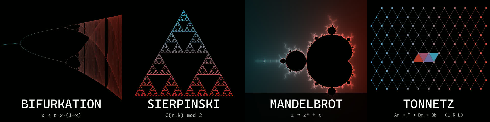
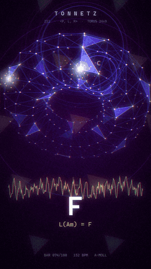
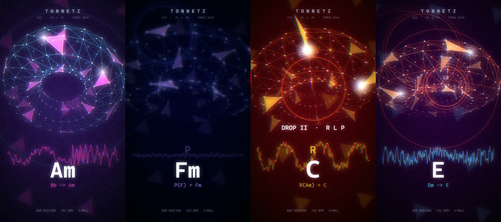
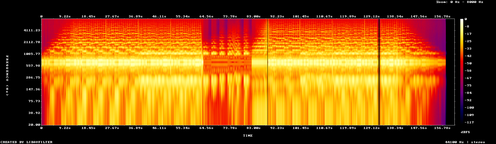

<div align="center">

# phonktion

**Hardstyle / drift phonk generated from mathematics. No samples, no DAW: every kick, bassline and melody is computed.**

[](https://www.python.org/)
[](https://numpy.org/)
[](https://scipy.org/)
[](https://ffmpeg.org/)
[](#how-it-works)
[](#use-as-a-claude-code-skill)
[](LICENSE)



</div>

phonktion renders complete tracks (about 2:10 to 2:40, intro, drops, breaks, outro) from four mathematical themes.
Every track is controlled by one required knob, **intensity** (1 to 10), plus optional key, tempo and a seed that varies
the mathematical starting values. The `tonnetz` theme also renders a 1080×1920 music video in which every note,
chord change and kick is drawn from the exact score data rather than from an audio analysis.

## Listen

30-second excerpts (MP3, 160 kbit/s):

| Track | Theme | Key / BPM | Excerpt |
|---|---|---|---|
| BIFURKATION | Logistic map, period doubling into chaos | D# phrygian, 144 | [bifurkation.mp3](docs/audio/bifurkation.mp3) |
| SIERPINSKI | Pascal's triangle mod 7, Rule 30, Thue–Morse | F# phrygian, 144 | [sierpinski.mp3](docs/audio/sierpinski.mp3) |
| MANDELBROT | Bulb periods of the Mandelbrot set, Julia gates | G# phrygian, 144 | [mandelbrot.mp3](docs/audio/mandelbrot.mp3) |
| TONNETZ | Neo-Riemannian chord progressions on a torus | A minor, 152 | [tonnetz.mp3](docs/audio/tonnetz.mp3) |

## Visuals

<p align="center">
  
  &nbsp;
  
</p>

The Tonnetz is drawn as a 24×9 lattice wrapped onto a torus. The pitch class at lattice point (i, j) is 7i + 4j mod 12,
so every triangle is a major or minor triad. On each chord change the active triangles fold over their shared edge,
which is what the neo-Riemannian operations P, L and R are geometrically: a reflection of a triangle across one of its edges.
Arpeggio notes flash their lattice points, lead notes emit rings, tritone stabs draw a bolt to the opposite pitch class,
filter sweeps become blur, tape stops squash the frame and ratchets stutter it.

## How it works

Each theme turns one piece of mathematics into the musical decisions a producer would normally make by hand.

| Theme | Melody / harmony | Rhythm and effects | Noise source |
|---|---|---|---|
| `bifurkation` | Stable orbits of x → r·x·(1−x) become the hook. The track walks r through period 2, 4, 8 and 3 into chaos and back to the fixed point. | Collatz sequence for bass glides, Zeno roll (geometric series that converges on the drop), Cantor-set gate, Fibonacci-word hook rhythm | Logistic map at r ≈ 4 |
| `sierpinski` | Rows of Pascal's triangle mod 7 as scale degrees. Row 7 is almost all zeros (Lucas' theorem), which produces a built-in rest and fill every eighth bar. | Thue–Morse sequence for root/fifth bass, Sierpinski gate (k is audible iff C(r, k) is odd), binary roll | Wolfram's Rule 30 |
| `mandelbrot` | Bulbs on the main cardioid at internal angle p/q have period q. Bulb centres are found with Newton's method on f_c^q(0) = 0; the cycle points ranked by angle become the melody (1/3 → 2/5 → 3/8, then the golden angle). | Boll's π: escape time at c = ¼ + ε grows like π/√ε and drives the build-up roll. Shepard tone as infinite zoom, Julia-set gate, bit depth per bar from escape times near the boundary | z → z² − 2 (antenna tip) |
| `tonnetz` | Chord progressions are words in the group ⟨P, L, R⟩: `LRL` gives Am–F–Dm–B♭, `RLP` gives Am–C–Em–E, `LPLPLP` is the hexatonic cycle used for the break. | Gray-code arpeggio over chord tones, voice-led sustained lead, kick tuned to the current chord root, filter sweeps, tritone stabs | Rule 30 |

All instruments are synthesized with NumPy/SciPy: two-stage pitch-swept kicks with hard clipping, distorted sub bass with
glides, drift-phonk leads built only from harmonic partials, 808-style claps, FM screeches, and a reverb whose impulse
response is the chosen chaotic noise. The master chain is saturation, a look-ahead limiter and a clipper.

### Measured against a reference

The style target was set by measuring tracks of the artist PINKY SMASH (no audio from them is used or included).
`tools/full.py` and `tools/bass.py` report tempo, key, band balance, crest factor, sidechain depth, bass progression and
section structure. For TONNETZ the bass progression is recovered exactly from the rendered audio:

```text
tonnetz.wav   Wechsel/halbtakt 0.43   A A F F D D A# A# A A F F D D A# A# ...
```



## Quick start

Requirements: Python 3.11+, FFmpeg on the `PATH`, and for the visuals pycairo and OpenCV.

```bash
git clone https://github.com/Silvertree2010/phonktion.git
cd phonktion
pip install -r requirements.txt

python tools/make.py --theme tonnetz --intensity 8 --key F# --seed 1 --title "Hexagon" --slowed
```

The project folder (default `~/Music/<title>/`) then contains:

| File | Content |
|---|---|
| `<title>.wav`, `<title>.mp3` | the track |
| `<title>.mp4` | cover with live waveform |
| `cover.png` | cover rendered from the theme's mathematics |
| `<title>_super_slowed.mp3` | with `--slowed`: tape-style slowdown by 0.797 plus reverb |
| `<title>_visuals_tiktok.mp4` | with `--visuals` (theme `tonnetz`): 1080×1920 video |
| `src/` | the generator and its `params.json`, so the track can be re-rendered or edited |

Rendering the audio takes 10 to 25 seconds. The visuals take about 6 minutes on 16 cores.

## Options

| Option | Values | Default |
|---|---|---|
| `--theme` | `bifurkation`, `sierpinski`, `mandelbrot`, `tonnetz` | required |
| `--intensity` | 1 (soft) to 10 (brutal) | required |
| `--key` | root of the minor key, e.g. `A`, `F#`, `Eb` | theme default |
| `--bpm` | 125 to 165 works well | 144 (`tonnetz`: 152) |
| `--seed` | integer, varies the mathematical starting values | 0 |
| `--crush` | 0 to 1, extra bitcrush on the music bus | derived from intensity |
| `--title` | track title | theme name |
| `--out` | output folder | `~/Music/<title>` |
| `--slowed` | also render a super-slowed version | off |
| `--visuals` | render the synced video (theme `tonnetz` only) | off |

Intensity scales several stages at once. Intensity 6 with default key, tempo and seed reproduces the original tracks bit for bit.

| | 1 | 6 | 10 |
|---|---|---|---|
| Kick distortion | ×0.6 | ×1.0 | ×1.3 |
| Limiter | soft, more dynamics | original | heavily compressed |
| Sidechain depth | 0.35 | 0.6 | 0.8 |
| Bitcrush (music above 150 Hz) | off | off | 5 bit, sample-and-hold ×4 |
| Visual effects | calm | original | chaotic |

The seed changes something audible in every theme. In `tonnetz` it selects the progressions: drop 1 from `LRL`, `RLR`,
`LPL`, `LRP` and drop 2 from `RLP`, `LRL`, `RLR`, `PLR`.

## Use as a Claude Code skill

The repository root is a [Claude Code](https://claude.com/claude-code) skill (`SKILL.md`):

```bash
ln -s "$(pwd)" ~/.claude/skills/phonktion
```

Claude then asks for intensity and theme if they are missing, runs `tools/make.py`, reads the measurements and checks
key, bass progression, structure and sub frequency before reporting. The skill text is in German.

## Repository layout

```text
SKILL.md                 skill description and the rules learned while building the tracks
templates/
  bifurkation.py         generator per theme (instruments, arrangement, mixdown)
  sierpinski.py
  mandelbrot.py
  tonnetz.py
  visual_tonnetz.py      frame renderer for the Tonnetz video (pycairo + OpenCV)
  cover_*.py             cover art per theme
tools/
  make.py                one-command build: render, measure, encode, cover, video
  slowed.py              super-slowed version
  full.py, bass.py, chroma.py   analysis used to compare against reference tracks
docs/                    screenshots and audio excerpts for this README
```

## Limitations

- Visuals exist only for `tonnetz` so far.
- Arrangements are fixed per theme; length cannot be set.
- The generators were written iteratively and keep their comments in German.

## Credits

The idea came from a TikTok by WXRMANE that built a hardstyle track from plotted formulas. The sound target follows
the drift-phonk style of PINKY SMASH; no samples or audio from either were used.

## License

[MIT](LICENSE)
